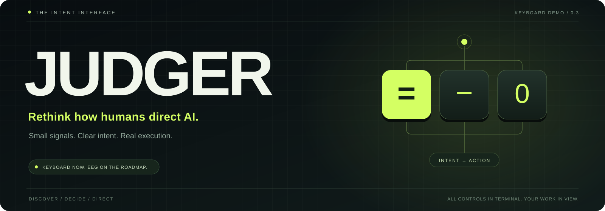

<div align="center">
  
  <br><br>
  
  <br><br>
  <strong>An intent interface for AI agents.</strong><br>
  Discover what you want. Decide with three keys. Keep directing while the work gets done.
  <br><br>
  <a href="#try-judger">Try the demo</a> ·
  <a href="#the-interaction-model">How it works</a> ·
  <a href="#from-keyboard-to-eeg">The EEG roadmap</a> ·
  <a href="README.zh-CN.md">简体中文</a>
</div>

<br>

## Your intent is the interface.

AI can turn a brief into code, an article, or a working webpage. Giving it the right brief—and keeping it aligned as your ideas develop—still asks a lot of the person at the keyboard.

**Judger reimagines that exchange as a continuous loop of questions, decisions, and action.** The system proposes a small, concrete question. You make a judgment. It narrows the possibilities, builds a clearer understanding of your intent, and puts an agent to work.

You can begin with an incomplete idea. You can keep shaping the result while the agent works. You can revisit an earlier decision and change direction.

```text
JUDGER                                      MAIN QUESTION

    Is it for other people?

    = Yes                   - No                  0 Rephrase
```

The larger ambition is an interaction vocabulary that can travel across tasks, agents, and input devices. **This repository is the working keyboard demo of that idea.**

## A small vocabulary. A continuous conversation.

<table>
<tr>
<td width="33%" valign="top">
<strong>01 / Discover</strong><br><br>
Short, Akinator-inspired questions turn an incomplete idea into an actionable brief. Follow-up questions are prepared ahead of time.
</td>
<td width="33%" valign="top">
<strong>02 / Direct</strong><br><br>
Keep answering side questions while the agent executes. New decisions become updates to the same task, including an active Codex turn.
</td>
<td width="33%" valign="top">
<strong>03 / Refine</strong><br><br>
Tune a webpage from Terminal and watch the actual page change in Chrome. Revisit decisions, withdraw answers, and continue after completion.
</td>
</tr>
</table>

## The interaction model

The physical vocabulary stays small. The visible question and current mode give each trigger its context.

| Context | `=` | `-` | `0` |
| :--- | :--- | :--- | :--- |
| **Main question** · the agent needs your answer | Yes | No | Rephrase the question |
| **Side question** · execution continues | Yes | No | Send collected answers now |
| **Live controls** · adjust a selected category | Increase | Decrease | Send current adjustments now |

No Enter is needed for triggers. `=` uses its own key without Shift.

Side answers automatically submit after two choices by default, or after each choice with `--auto-submit 1`. The next cached question remains available after submission. The agent handles outstanding submitted requirements before reporting completion.

**A few more controls:**

| Key | Action |
| :--- | :--- |
| `b` / Backspace | Previous question; in live controls, undo the last adjustment |
| `v` | Open this session's answer history |
| `e` / Enter, then `=` / `-` | Change the selected historical answer |
| `r` | Withdraw a historical answer and subsequent answers |
| `C` | Enter or leave Terminal's split live-control view |
| `[` / `]` · also `【` / `】` | Switch live-control categories |
| `i` | Add free text; Enter sends, Esc cancels |
| `h` / `q` | Help / quit |

Changing an old answer withdraws later answers that may depend on it. Judger sends the corrected context to the executor; previously executed commands do not undo themselves.

## Try Judger

**Python 3.11+ · macOS or Linux · a real Terminal · no third-party Python runtime dependencies.**

```sh
git clone https://github.com/MarvinCui/Judger.git
cd Judger
```

### 1. Feel the interaction, offline

```sh
python3 main.py --demo
```

Try Terminal controls with a real webpage preview:

```sh
python3 main.py --demo --task 'Try the webpage controls'
```

Press `C` when the page is ready. Keep keyboard focus in Terminal; Chrome displays the project webpage. Offline examples are scripted and make no model requests.

### 2. Discover intent and do real work

Configure your own DeepSeek key using the hidden-input prompt:

```sh
python3 main.py --setup
python3 main.py --check
python3 main.py
```

Or provide `DEEPSEEK_API_KEY` in your environment. Keys belong in local configuration, never in source files. **No key is distributed with this repository.**

Start from a clue:

```sh
python3 main.py --task 'I want to make something for my portfolio.'
```

Write and test code with local command execution enabled:

```sh
python3 main.py --allow-shell --task 'Build a small Python timer.'
```

`--allow-shell` enables real local commands; it does not create an operating-system sandbox. File tools otherwise stay within the selected project and keep backups of overwritten files.

### 3. Put Codex to work

Install and sign in to Codex CLI separately, then run:

```sh
codex login
python3 main.py --codex --task 'Help me design a personal website.'
```

DeepSeek handles intent discovery and background questions. Once the brief is clear, Judger sends it to a local [Codex app-server](https://developers.openai.com/codex/app-server/) session.

During execution, submitted side answers steer the active Codex turn. If it has just finished, the update becomes a follow-up turn in the same conversation. Codex uses its own workspace sandbox and approval flow. Additional permission requests appear as main questions in Terminal.

### Every project gets its own space

New tasks receive a separate timestamped folder under `workbench/`. Continue an existing project with:

```sh
python3 main.py --codex --project ./workbench/your-project
```

Use `--workspace /path/to/projects` to choose the parent directory for new projects. An existing project resumes its saved Codex conversation; Judger's question history currently begins fresh on launch.

## Keep your hands in Terminal. Keep your work in view.

**Judger's software UI stays entirely in Terminal.** Chrome previews only the webpage being developed. All questions, categories, trigger input, text entry, history, and corrections remain in the terminal.

Press `C` to reveal categories for **color, boldness, density, detail, and expression**. Switch with brackets and adjust with `-` / `=`.

- Color, typography, spacing, and decoration update through a saved stylesheet and a local preview server.
- A brief pause coalesces adjustments into one update to the executor.
- Changes to the HTML automatically refresh the preview.
- Content rewrites and structural changes appear after the agent actually finishes those edits.

The current preview supports **static HTML with relative assets**. React/Vite development-server integration is a future extension. Select another HTML entry with `--preview-file pages/index.html`.

## From keyboard to EEG

> **The long-term goal: a keyboard trigger and an EEG trigger should express the same decision.**

The keyboard demo lets us explore the interaction vocabulary before committing to a hardware interface. The proposed next step is to map a small set of calibrated EEG classifications onto the same contextual triggers.

| Input | Mapping | Status |
| :--- | :--- | :--- |
| **Keyboard** | Physical `=` / `-` / `0` keys → contextual decisions → agent action | Implemented |
| **EEG** | Calibrated signal classes → confidence and idle-state handling → equivalent triggers → the same decision loop | Research roadmap |

The EEG program would investigate:

- Which signal paradigm and trigger count provide a useful balance of reliability, speed, training effort, and cost.
- How personal calibration, an explicit no-command state, and confidence thresholds can reduce accidental actions.
- Whether a compact, low-channel device can support the interaction in everyday conditions.
- How keyboard fallback, correction, and confirmation should work when classification is uncertain.

**EEG acquisition, decoding, model training, and hardware are not implemented here.** We have not established an optimal trigger count, validated EEG accuracy, or demonstrated a hardware system. Three keyboard triggers are the current product experiment.

## Why build this layer?

Our thesis is that directing capable agents can become a product surface of its own: **a reusable interface between human intent and machine execution.**

Judger starts with tasks people can inspect today—writing, code, and webpages. A compact trigger vocabulary creates a path toward other input devices while retaining the same ability to clarify, correct, and steer.

The next research milestone is to measure the interaction: task completion, input effort, decision latency, correction frequency, and user understanding. The product thesis is testable; comparative productivity gains remain to be established.

## What is real today

| Available in this demo | Next areas to explore |
| :--- | :--- |
| Immediate three-key input in Terminal | Measured comparisons with prompt-based workflows |
| Seven-level main-question precomputation | Better question selection and cache efficiency |
| Side questions during execution | A formal adapter interface for other input devices |
| Codex delegation and in-flight updates | EEG classification and calibration experiments |
| Historical corrections and live HTML tuning | Compact hardware feasibility and broader preview targets |

Seven binary levels contain **127 question nodes and 128 complete answer paths**. These are speculative paths, not 127 user decisions. Initial planning, network requests, and cache refills still take time and consume model usage. The UI returns to execution as soon as it has enough information.

## Explore the implementation

| Location | Purpose |
| :--- | :--- |
| [`trigger_agent/prompts/`](trigger_agent/prompts/) | Intent discovery, question style, and speculative planning |
| [`state.py`](trigger_agent/state.py) | Contextual key semantics, answer history, and feedback state |
| [`engine.py`](trigger_agent/engine.py) | Agent loop, tools, planners, and offline demos |
| [`codex_bridge.py`](trigger_agent/codex_bridge.py) | Persistent Codex conversation and active-turn updates |
| [`execution.py`](trigger_agent/execution.py) | Terminal-owned live controls and preview-only serving |
| [`ui.py`](trigger_agent/ui.py) | The Terminal interface |

The internal Python package remains `trigger_agent` for compatibility with the original demo. The product and interface are **Judger**.

### Validate the demo

```sh
python3 -m unittest discover -s tests -v
python3 tests/terminal_smoke.py
python3 tests/terminal_execution_smoke.py
```

Opt-in real-model checks use your own configured account:

```sh
python3 tests/live_smoke.py
python3 tests/live_revision.py
python3 tests/live_codex.py --agent
```

Browser checks and their optional dependencies are described in [development notes](docs/DEVELOPMENT.md). See [QA.md](QA.md) for verified coverage and practical limits.

### Local data

`.local/` contains private key configuration, optional session logs, and local QA artifacts. `workbench/` contains generated projects. Both are ignored by Git. Project metadata and backups live in `.trigger-agent/`; live styles use `trigger-style.css` for compatibility with the prototype.

Session logs can include prompts and file content. `--no-log` disables Judger's conversation and key-event logs; project metadata, backups, and Codex's own records may still be written. Do not commit generated projects or private configuration.

## Build the next interaction

We welcome work on question design, interaction evaluation, accessible controls, executor integrations, and future input adapters. Start a discussion through the repository's [issues](https://github.com/MarvinCui/Judger/issues).

Judger is released under the [MIT License](LICENSE).

---

<div align="center">
  <strong>JUDGER</strong><br>
  Small signals. Clear intent. Real execution.
</div>
